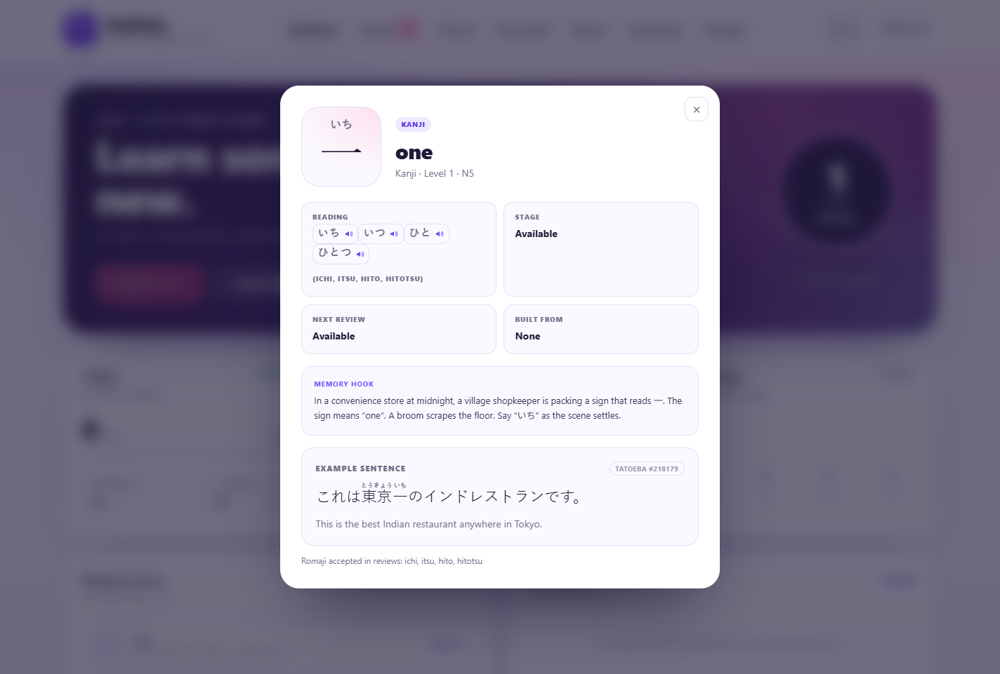
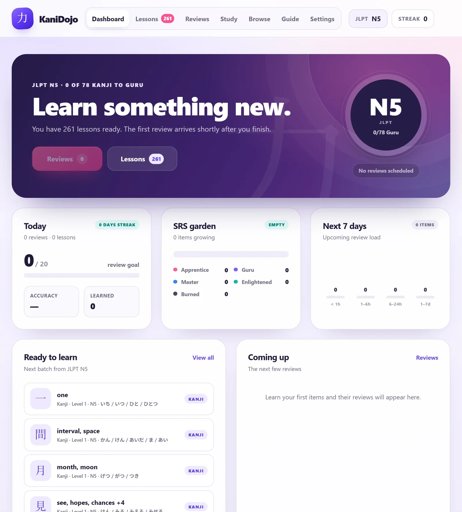
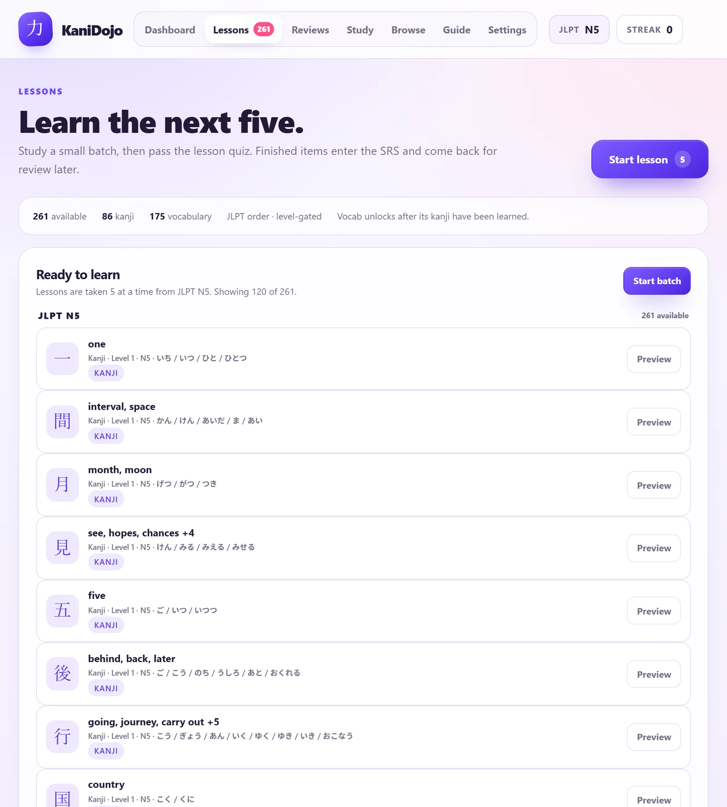
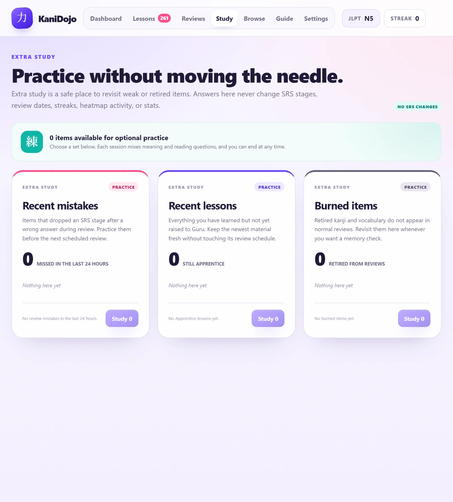

# KaniDojo v2

KaniDojo is an offline Japanese SRS with 10,353 kanji and vocabulary items and audio for every reading.

**Live site:** https://rafdro18-developer.github.io/kanidojo-v2/  
**Open the app in your browser:** https://rafdro18-developer.github.io/kanidojo-v2/KaniDojo-v2.html  
**Release:** https://github.com/rafdro18-developer/kanidojo-v2/releases/tag/v2.0.0

## About KaniDojo

KaniDojo is a solo beta project made because I was tired of subscriptions. It is a Japanese SRS with no account, no server, and no tracking. Download it, open it, and study.

The name comes from kanji feeling like a crab biting my behind sometimes.

## First run

- Leave the pace on **Standard** for normal study. **Demo pace** is only for quickly testing and burning items.
- The placement test covers 20 kanji and can skip up to Level 20. I do not recommend it unless you already know the early material.
- **Kana-only vocabulary** is included by default. You can skip it in Settings, but it is useful.
- The default daily review goal is 20. You can raise it or cap reviews in Settings.
- Standard intervals run from 4 hours to 4 months; an item burns after roughly 6 months.
- Use **Demo pace** only if you want to see the SRS cycle quickly.
- Export a JSON backup from Settings before clearing browser data or using a private window.

## Download

| Build | Download | Size |
|---|---|---|
| Windows installer | [KaniDojo-Setup-2.0.0.exe](https://github.com/rafdro18-developer/kanidojo-v2/releases/latest/download/KaniDojo-Setup-2.0.0.exe) | 139 MB |
| Windows portable | [KaniDojo-2.0.0-win-x64-portable.zip](https://github.com/rafdro18-developer/kanidojo-v2/releases/latest/download/KaniDojo-2.0.0-win-x64-portable.zip) | 180 MB |
| Linux single file | [KaniDojo-2.0.0-linux-x64.run](https://github.com/rafdro18-developer/kanidojo-v2/releases/latest/download/KaniDojo-2.0.0-linux-x64.run) | 140 MB |
| Linux archive | [KaniDojo-2.0.0-linux-x64.tar.gz](https://github.com/rafdro18-developer/kanidojo-v2/releases/latest/download/KaniDojo-2.0.0-linux-x64.tar.gz) | 140 MB |
| Standalone HTML | [KaniDojo-v2.html](https://github.com/rafdro18-developer/kanidojo-v2/releases/latest/download/KaniDojo-v2.html) | 39.7 MB |
| Browser | [Launch in browser](https://rafdro18-developer.github.io/kanidojo-v2/KaniDojo-v2.html) | No install |

The standalone file contains the app and all audio in one HTML file. The Windows and Linux installers are unsigned, so SmartScreen may warn on Windows.

## Features

- 10,353 kanji and vocabulary items
- 60 frequency-based levels and JLPT N5–N1 tracks
- 8,155 unique reading clips
- One consistent voice: Deepgram Aura-2 `aura-2-izanami-ja`
- Native Ogg Opus audio, mono, 24 kbps, 48 kHz
- Japanese example sentences with furigana and English translations
- Tatoeba source links
- Lessons, reviews, extra study, browse, heatmap, and JSON backup/import
- Placement test, kana-word skipping, review goals, and review caps
- Vacation mode, make-reviews-due, undo mistakes, and unburn
- Furigana, romaji, dark mode, and six UI sizes
- Hiragana/katakana chart in Instructions
- Local progress storage
- No account, analytics, server, or runtime text-to-speech

Example sentence audio is intentionally not included. The sentence text, furigana, translation, and Tatoeba link remain.

## Screenshots

<table>
<tr>
<td> First run</td>
<td> Dashboard</td>
</tr>
<tr>
<td> Lessons</td>
<td> Extra study</td>
</tr>
</table>

[Full dashboard](screenshots/dashboard.webp) · [Settings screen](screenshots/settings.webp)

## Run

- **Windows:** run the installer, or extract the portable ZIP and launch `KaniDojo.exe`.
- **Linux:** `chmod +x KaniDojo-2.0.0-linux-x64.run && ./KaniDojo-2.0.0-linux-x64.run`
- **Browser:** [launch the app](https://rafdro18-developer.github.io/kanidojo-v2/KaniDojo-v2.html), or open `KaniDojo-v2.html` locally.
- **Android/macOS:** use the standalone HTML in a modern browser.

The app starts with a small splash window and stores progress locally.

## Progress warning

Progress is stored in your browser or desktop app data. It will be lost if you use a private window, clear cookies, or delete app data.

- Windows: `%APPDATA%\KaniDojo\Local Storage\leveldb`
- Linux: `${XDG_CONFIG_HOME:-~/.config}/KaniDojo/Local Storage/leveldb`
- Standalone HTML: the browser profile's localStorage
- Storage key: `kanidojo_state_v1`

Use **Settings → Data & settings** to export or import a JSON backup. Do this regularly.

Reset all levels works as many times as you want. It clears lessons, reviews, stats, streak, and settings and returns to the welcome screen. Resetting one device does not reset another.

## Audio

- Voice: Deepgram Aura-2 `aura-2-izanami-ja`
- 8,155 clips, all one voice
- Format: Ogg Opus
- Bitrate: 24 kbps mono
- Sample rate: 48 kHz
- Total audio: 26.90 MB

## Data and licensing

- Curriculum: [OpenJLPT](https://github.com/evanclan/OpenJLPT), **CC BY-SA 4.0**
- Adapted curriculum and frequency-based 60-level ordering: **CC BY-SA 4.0**
- 60-level structure is not claimed as unique; WaniKani also uses 60 levels. KaniDojo is not affiliated with WaniKani.
- Example sentences: [Tatoeba](https://tatoeba.org/), **CC BY 2.0 FR**, with source links retained
- Reading audio: Deepgram Aura-2, AI-generated
- No API key is included in this repository

The source code is **MIT licensed** (see `LICENSE`). The curriculum remains CC BY-SA 4.0, Tatoeba sentences remain CC BY 2.0 FR, and the Deepgram-generated audio is subject to Deepgram terms. See `NOTICE.md` for the split.

## Beta feedback and testing

KaniDojo is an unofficial solo beta project. I welcome testing for errors and would especially appreciate corrections on readings, example sentences, onboarding, SRS behavior, missing or broken audio, and platform-specific issues.

If you find a problem, please include the item or level, what happened, and what you expected. You can [open an issue](https://github.com/rafdro18-developer/kanidojo-v2/issues) or leave a comment on the feedback thread.

KaniDojo is not affiliated with WaniKani, Tofugu, OpenJLPT, Tatoeba, or Deepgram.

## Known limitations

- The Windows installer and portable ZIP are unsigned.
- The Windows portable ZIP extracts once; later launches are fast.
- The Linux `.run` uses `--no-sandbox` because setuid permissions are not preserved in a user-level archive.
- The Linux build expects standard desktop libraries (GTK 3, NSS, ALSA, X11/Wayland, GBM).
- Example sentences are text-only; sentence audio is not bundled.

## Development

Build, release, audio regeneration, and GitHub Pages instructions are in [BUILDING.md](BUILDING.md).
